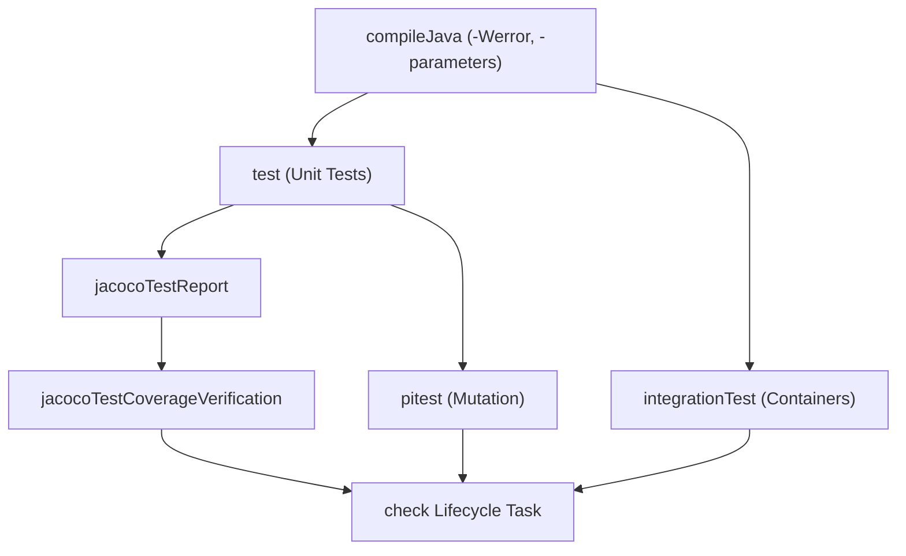

# JVM Test Suites & Automated Quality Tooling

Modern Gradle elevates test and quality configuration from manual task hacking to native **JVM Test Suites (`testing { suites { ... } }`)**, parallel fork management, and automated quality gates (Jacoco and Pitest).

---

## 1. JVM Test Suites (`testing { suites { ... } }`)

Gradle's JVM Test Suite plugin natively models distinct test types (unit, integration, functional) without requiring manual `SourceSet` and `Test` task plumbing.

### Configuring the Default Unit Test Suite

```kotlin
// In build-logic/src/main/kotlin/myproject.java-common-conventions.gradle.kts
testing {
    suites {
        val test by getting(JvmTestSuite::class) {
            useJUnitJupiter()

            targets {
                all {
                    testTask.configure {
                        // Parallel test execution across forks
                        maxParallelForks = (Runtime.getRuntime().availableProcessors() / 2).coerceAtLeast(1)

                        // Clear test logging
                        testLogging {
                            events("passed", "skipped", "failed")
                            showExceptions = true
                            showCauses = true
                            showStackTraces = true
                        }
                    }
                }
            }
        }
    }
}
```

### Registering a Dedicated Integration Test Suite

Register an isolated `integrationTest` suite with its own source directory (`src/integrationTest/java`):

```kotlin
testing {
    suites {
        val integrationTest by registering(JvmTestSuite::class) {
            useJUnitJupiter()

            dependencies {
                implementation(project()) // Depends on main module production output
                implementation(libs.bundles.testing)
                implementation(libs.testcontainers.postgresql)
            }

            targets {
                all {
                    testTask.configure {
                        shouldRunAfter(test)
                        maxParallelForks = 1 // Integration tests with containers often run sequentially
                    }
                }
            }
        }
    }
}

// Ensure ./gradlew check runs both unit and integration suites
tasks.named("check") {
    dependsOn(testing.suites.named("integrationTest"))
}
```

---

## 2. Strict Compiler Flags & Linting

Enforce zero-warning tolerance and preserve parameter metadata for reflection/DI frameworks:

```kotlin
tasks.withType<JavaCompile>().configureEach {
    options.encoding = "UTF-8"
    options.compilerArgs.addAll(
        listOf(
            "-parameters",       // Preserves method parameter names for Spring/Jackson
            "-Xlint:all",        // Enables all standard compiler warnings
            "-Xlint:-processing",// Suppresses annotation processing noise
            "-Werror"            // Treats all warnings as errors in CI
        )
    )
}
```

---

## 3. Jacoco Coverage Verification

Enforce automated code coverage thresholds during the `./gradlew check` lifecycle:

```kotlin
plugins {
    jacoco
}

jacoco {
    toolVersion = "0.8.12"
}

tasks.jacocoTestReport {
    dependsOn(tasks.test)
    reports {
        xml.required.set(true)
        html.required.set(true)
    }
}

tasks.jacocoTestCoverageVerification {
    dependsOn(tasks.test)
    violationRules {
        rule {
            element = "BUNDLE"
            limit {
                counter = "INSTRUCTION"
                value = "COVEREDRATIO"
                minimum = "0.80".toBigDecimal() // 80% instruction coverage
            }
            limit {
                counter = "BRANCH"
                value = "COVEREDRATIO"
                minimum = "0.75".toBigDecimal() // 75% branch coverage
            }
        }
    }
}

// Automatically verify coverage when running ./gradlew check
tasks.named("check") {
    dependsOn(tasks.jacocoTestCoverageVerification)
}
```

---

## 4. Pitest Mutation Testing Configuration

Mutation testing verifies that tests actually fail when defects are injected. Configure the Pitest Gradle plugin (`info.solidsoft.pitest`):

```kotlin
plugins {
    id("info.solidsoft.pitest")
}

pitest {
    junit5PluginVersion.set("1.2.1")
    targetClasses.set(listOf("com.example.app.*"))
    targetTests.set(listOf("com.example.app.*Test"))
    threads.set(Runtime.getRuntime().availableProcessors())
    outputFormats.set(listOf("XML", "HTML"))
    timestampedReports.set(false)
    mutationThreshold.set(80) // Fail if mutation score falls below 80%
}
```

---

## 5. Clean Lifecycle Integration

Wire all verification tasks to Gradle's standardized `check` lifecycle:


